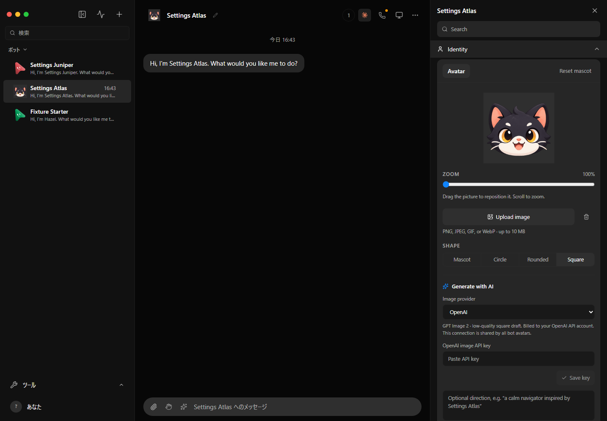
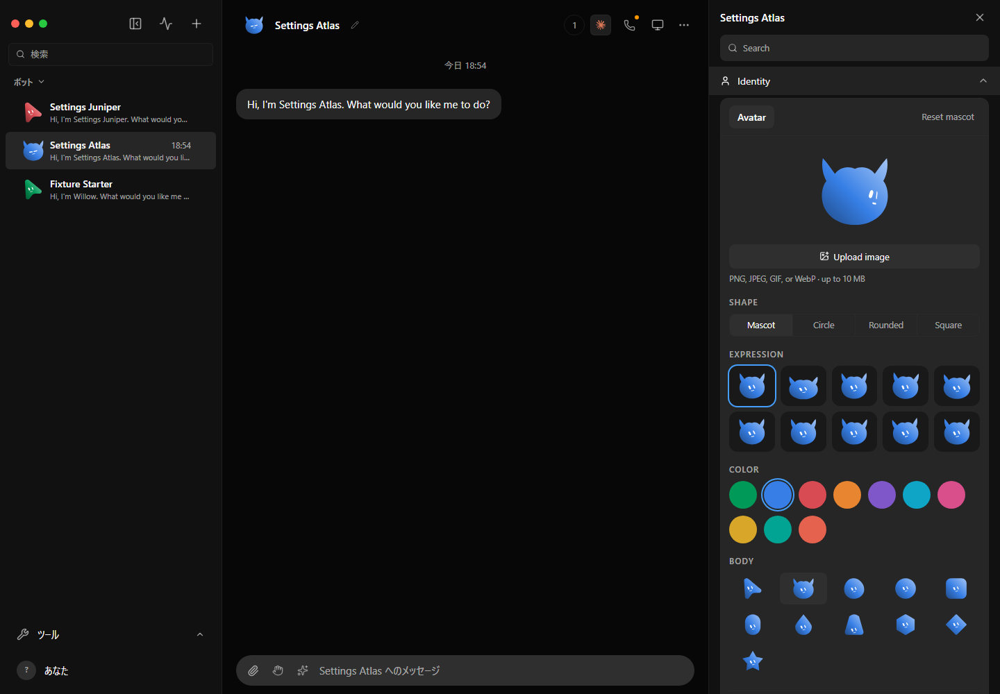

# Native cat mascot verification

The cat uses the standard mascot renderer, face, gradient, pointer gaze, and
expression controls. Its outline is generated from the same body catalog as
the cursor. Uploaded transparent images also keep their alpha instead of
receiving a forced background.

Verified on 2026-10-21 in the real browser app against the isolated bot-settings
fixture, with disposable data and the fake engine:

- Selected Cat through Identity, saved it, and reloaded the app. The sidebar,
  chat header, and profile all rendered SVG mascots with no image attachment.
- Selected working, thinking, and happy expressions. Each save returned 200
  and the matching face appeared. Restored automatic expression selection.
- Moved the pointer over the cat. Browser captures showed changing eye/face
  pixels. The recording below comes from that app session.
- Confirmed that a transparent image's corner alpha was zero before the fix,
  while its wrapper supplied an opaque background. After the fix the wrapper
  background was transparent.
- Ran `pnpm gen:bodies`, 76 focused tests, `pnpm typecheck`, and `pnpm lint`.
  Geometry checks covered every authored face at four gaze extremes. Existing
  body geometry and the shared face scale remained unchanged.

Focused test command:

```sh
pnpm exec vitest run server/bot-profile.test.ts src/components/Avatar.test.ts src/components/BotProfileAvatarCard.test.ts scripts/mascot-bodies
```

This verifies the browser app and generated mobile geometry. It does not claim
a packaged Electron, iOS, or Android runtime check.

## Before



## After



[Recorded pointer and face motion](motion.mp4)
