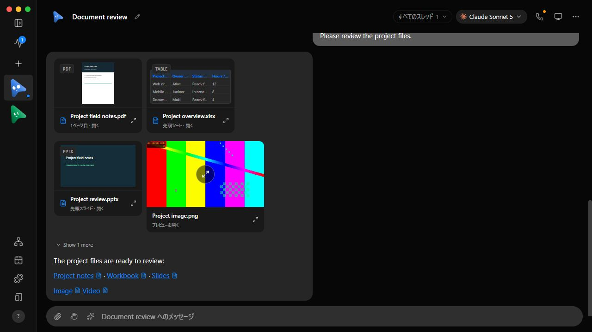
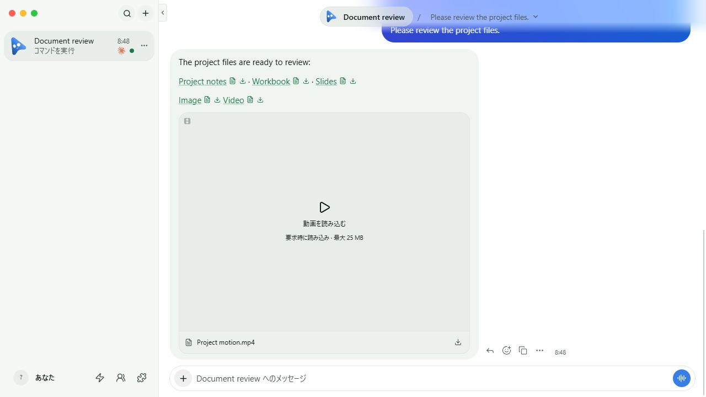
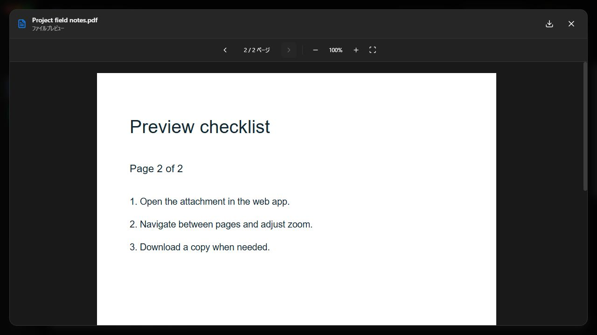
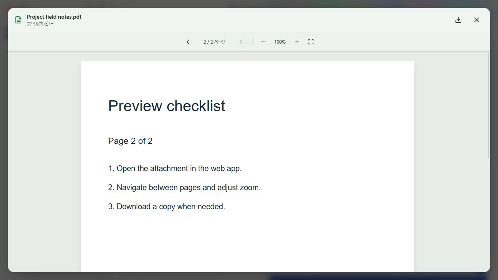
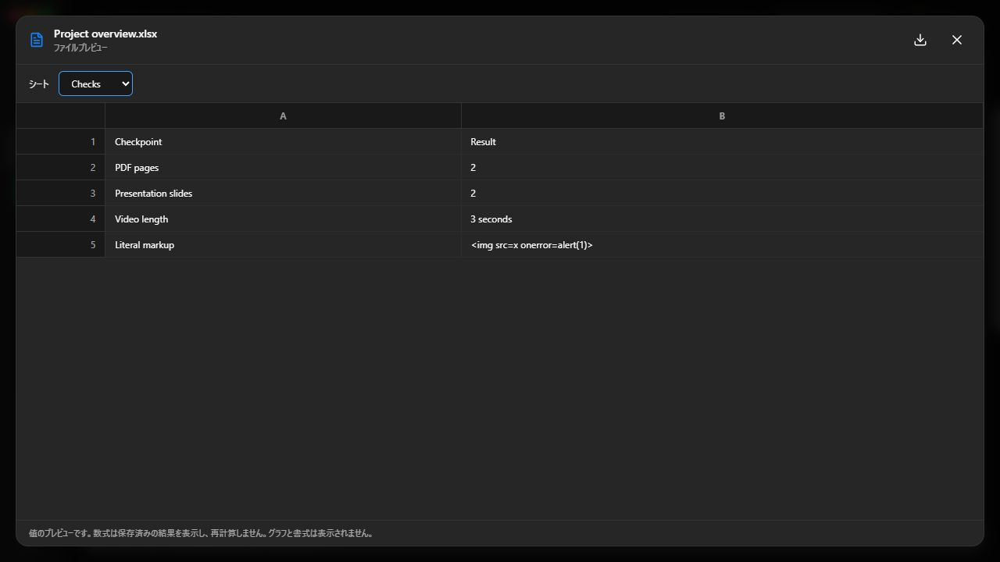
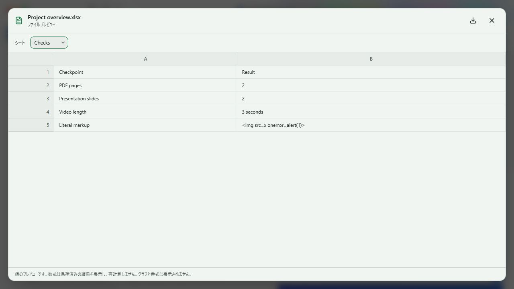
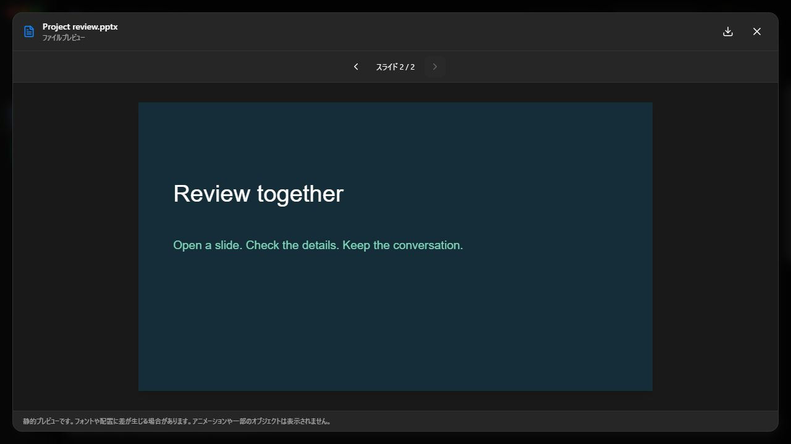
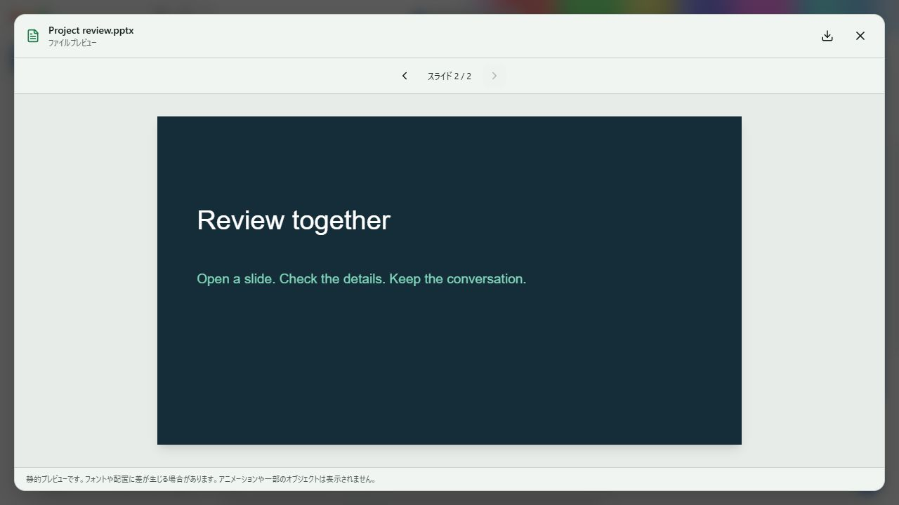
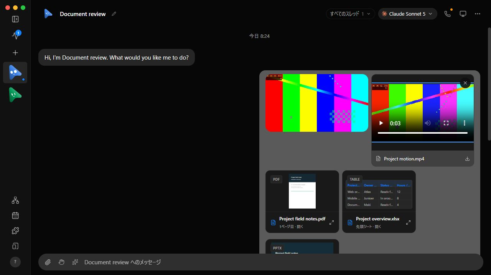
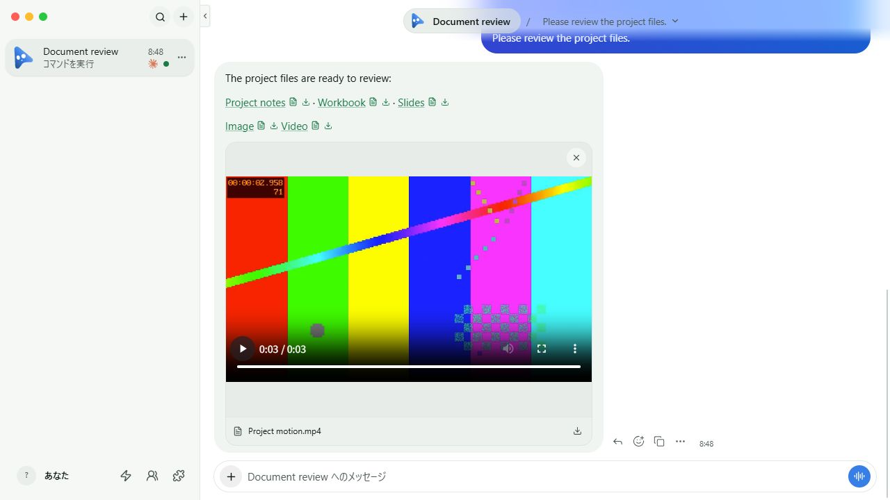

# OpenMakiBot upstream synchronization — 2026-10-25

This original evidence snapshot covers the first integration of fork/develop `717ab09f` with pinned
`milind-soni/OpenMausBot` main commit `03a6e88bc13ad2c2fb5c16a80d1a0b732b88d588`
(package version `0.1.127`). The merge was prepared on
`codex/sync/upstream-20261025`. The content through the CI compatibility notes records that earlier snapshot, not the later `f9191b5` integration or the update-check follow-up below.

The merge keeps the OpenMakiBot identity and fork-only publishing boundaries.
Upstream HTML, CSV/TSV table previews, folder listings, outside-workspace
guidance, browser/page openers, thread links and Markdown behavior are retained.
The fork's image, PDF, video, XLSX/XLS/ODS and PPTX previews remain message-
scoped. PDF and Office preview actions coexist with upstream save and folder
handling; CSV/TSV stay on the upstream table preview path.

Upstream removed the Android and iOS source trees. Their protected status names
remain as conditional checks: they skip while the trees are absent, and fail if
the sources return before native verification is restored. This is not native
test coverage. The fork's Vitest scope emits the real macOS, Ubuntu and Windows
shard matrix: 4 macOS, 8 Ubuntu and 8 Windows shards. Ubuntu runs all E2E tests; macOS and Windows use upstream host-dependent E2E selection.

## Isolated UI verification in the 03a6e88 snapshot

`scripts/verify-file-preview.ts --built` ran against a disposable fixture and
the production build. It used generated sample files and fake bot responses,
then exited through the fixture's normal `stop` cleanup path. It did not use the
live app or user data.

| Surface | Before | After |
| --- | --- | --- |
| Chat and attachment gallery |  |  |
| PDF page 2 |  |  |
| Workbook Checks sheet |  |  |
| PPTX slide 2 |  |  |
| Loaded video |  |  |

The final UI review confirmed PDF page `2/2`, the workbook Checks sheet with
literal markup preserved as text, PPTX slide `2/2`, and video playback from
paused through playback to a clean `3/3` end state. The video timing receipt is
in [after-video-playback.json](after-video-playback.json). The fixture closed
its tab, returned `cleaned: true`, and its process exited.

## Commands and results

- `pnpm install --lockfile-only --ignore-scripts` — completed with pnpm `10.33.0`.
- `pnpm install --frozen-lockfile --ignore-scripts` — completed; no lifecycle scripts ran.
- `node scripts/check-fork-policy.mjs` — passed; fork identity, repository guards, protected check names and 3 OS matrix structure are present.
- `node --test scripts/check-fork-policy.node-test.mjs` — 11/11 passed, including rejection when the fork Vitest matrix override is removed and when workflow-level external credentials lack repository guards.
- `pnpm exec vitest run scripts/ci-scope.test.ts scripts/ci-workflow.test.ts scripts/testing/verification-docs.test.ts` — 3 files and 86 tests passed.
- Fork scope runtime probe — emitted 20 shards (4 macOS, 8 Ubuntu, 8 Windows); Android and iOS source outputs were `false`.
- `pnpm i18n:check` — passed for 13 catalogs and 6,321 English source strings; Japanese has 6,319 translations.
- `pnpm exec vitest run scripts/ci-workflow.test.ts server/message-file.test.ts src/components/AttachmentPreview.test.ts src/components/ChatMarkdown.test.ts src/components/HtmlFilePreview.test.ts src/components/RichTable.test.ts src/components/AttachmentGallery.test.ts src/components/FilePreview.test.ts src/lib/file-preview.test.ts src/lib/load-file-preview.test.ts` — 9 files and 233 tests passed.
- `pnpm typecheck` — passed.
- `pnpm lint` — passed.
- `pnpm build` — passed, including the server TypeScript build and production Vite build.

Vite reported CSS warnings for `::highlight(search-result-text)` and
`::highlight(omb-citation-source)`, plus a chunk larger than 500 kB. The build
completed successfully.

## Remaining verification in the 03a6e88 snapshot

At the time of this snapshot, official CI on the candidate had not run. This
historical status does not describe the later runs listed below. Native
Android/iOS functionality is not covered because upstream removed those
projects. No publisher, release, deployment, Docker publish or external-secret
workflow was executed locally; the fork policy validator checked their
repository guards.

The inherited SheetJS dependency remains pinned to
`https://cdn.sheetjs.com/xlsx-0.20.3/xlsx-0.20.3.tgz`. Neither the fork-base
lock nor the regenerated lock records an integrity hash for this existing
tarball URL.

## CI compatibility repairs recorded for the earlier source tree

The workbook sheet picker now uses the shared Select component. The outside-workspace action and message-local file link live in separate components with direct imports. The line-size ratchet was lowered after extraction.

The repaired source passed 161 focused preview and ratchet tests, the Select guard, targeted lint, and a full production build including both TypeScript checks. An independent source review passed. The After images above were recaptured from that production build in a disposable fixture; PDF page 2, workbook Checks, PPTX slide 2, and video playback were confirmed again. Independent image review passed, and the fixture exited through normal cleanup. The [source hashes](source-hashes.json) bind those captures to the repaired preview components.

When this repair note was first written, hosted checks for that source tree
were still pending. An earlier run also reported Linux Cloud/home fixture
failures. These are historical results, not the status of PR #11 below.

## Later integration and PR #11

PR [#11](https://github.com/Sunwood-ai-labs/OpenMakiBot/pull/11) advances the sync to pinned upstream main `f9191b5384b9900b2371696336439ae5ad6e0117`. It merges that commit into fork/develop `717ab09facd7df729051292371841a0fe7399031` as `ae15688d56ef5137f55bbb3b17606166e890a3da`.

The fresh independent UI acceptance before the update-check follow-up records source commit `e0455bbf994e6c2a03d93a4bdb56711a9bd5fdb3` and tree `59cd80485d42bb16105cdf57b5eea57cc48ac1db`. It includes reviewer-observed desktop checks and root-performed 390×844 phone viewport checks. The pre-UI, post-UI, and final renderer manifests match across 281 files and 25,298,555 bytes. Their manifest SHA-256 is `7d31daff9dcf268730d7ec1be307040f87e564e8e03a9eb37f50e8a100089830`. The checks cover previews, phone navigation, keyboard focus, a composer draft, and approval controls. The detailed receipt remains in ignored local scratch and is not linked from this document.

The update-check follow-up changes only the server route. It returns `current`, `install`, and `available: false`. It does not request the OpenMausBot release feed or return a release URL, latest version, or update command. The generic upstream checker remains unchanged. The e0455bb UI receipt predates this route change and does not verify that route. The disposable HTTP route test below covers it.

The follow-up passed `pnpm exec vitest run server/update-check.test.ts server/routes/update-check.test.ts` with 10 tests, `pnpm typecheck`, `pnpm lint`, `node scripts/check-fork-policy.mjs`, and `pnpm exec vitest run scripts/testing/verification-docs.test.ts` with 7 tests.

Manual workflow-dispatch checks on `e0455bbf994e6c2a03d93a4bdb56711a9bd5fdb3` passed before this update-check follow-up: CI run [40164617755](https://github.com/Sunwood-ai-labs/OpenMakiBot/actions/runs/40164617755) finished with 41 successes and 3 skips out of 44 jobs, including all 20 Vitest shards. Fork policy [40164617574](https://github.com/Sunwood-ai-labs/OpenMakiBot/actions/runs/40164617574), Docker build and boot smoke [40164617732](https://github.com/Sunwood-ai-labs/OpenMakiBot/actions/runs/40164617732), and Docs [40164617523](https://github.com/Sunwood-ai-labs/OpenMakiBot/actions/runs/40164617523) also passed. The Docker publish step was skipped by the fork guard.

Those results do not verify the update-check follow-up. PR-triggered [CI run 40168626736](https://github.com/Sunwood-ai-labs/OpenMakiBot/actions/runs/40168626736) on e0455bb reported a failure in [Ubuntu browser-driver S4 job 121095214909](https://github.com/Sunwood-ai-labs/OpenMakiBot/actions/runs/40168626736/job/121095214909); that result is under separate investigation. The follow-up is local and has no hosted checks yet. After it is committed and pushed, PR #11 must pass checks on its new head before merge. Use the PR link above for the current check state.
